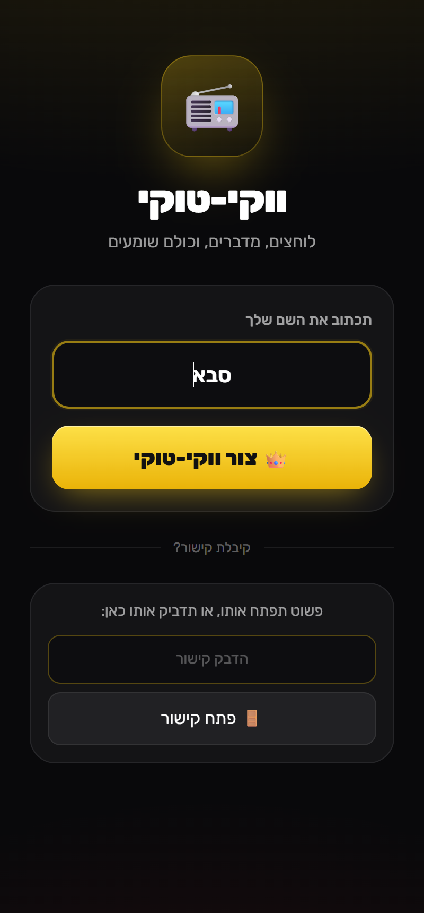
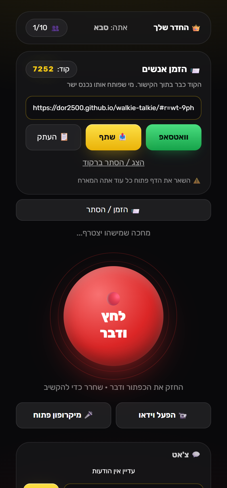
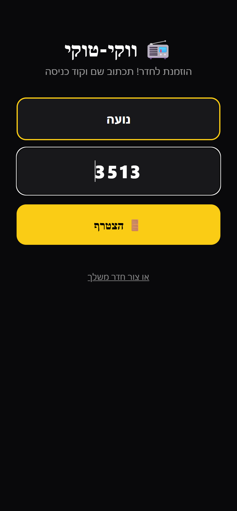
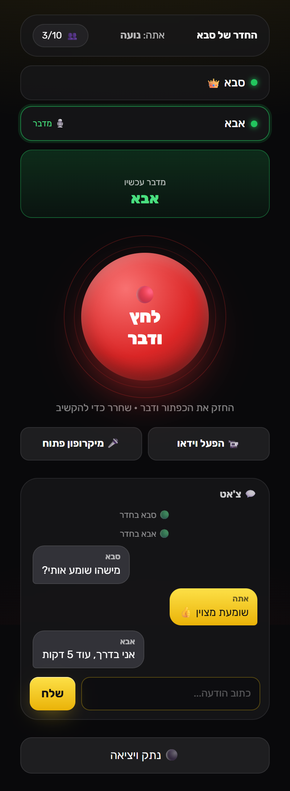
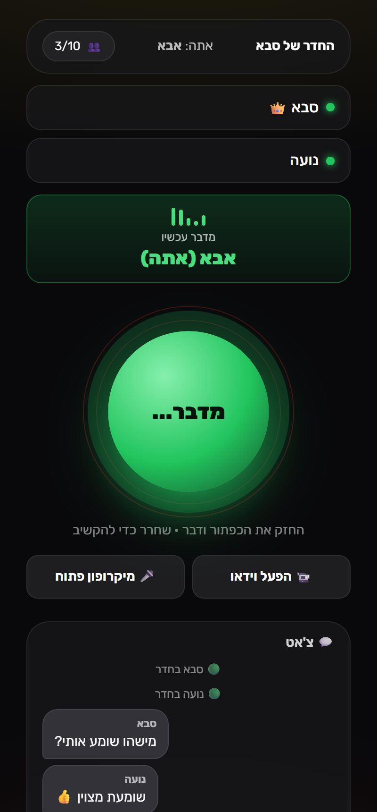
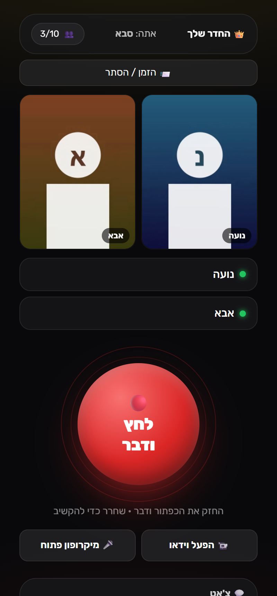

# 📻 ווקי-טוקי

ווקי-טוקי בדפדפן עם שיחת וידאו וצ'אט. המארח יוצר חדר ושולח קישור, החברים פותחים אותו, לוחצים "הצטרף" ומדברים.
לא צריך להתקין כלום או להירשם, ועד 10 אנשים יכולים להיות בחדר.

## ▶️ [לחצו כאן להפעלה](https://dor2500.github.io/walkie-talkie/)

**https://dor2500.github.io/walkie-talkie/**

## 🚀 איך משתמשים

1. **המארח** פותח את [הקישור](https://dor2500.github.io/walkie-talkie/), כותב שם ולוחץ **"צור ווקי-טוקי"**.
2. המארח מקבל **קישור הזמנה** שכבר כולל את **קוד הכניסה**. שולחים אותו בוואטסאפ, בשיתוף או בהעתקה, או מציגים ברקוד.
3. **החברים** פותחים את הקישור, כותבים שם ולוחצים **"הצטרף"**.
4. מחזיקים את **הכפתור האדום** ומדברים. כולם רואים מי מדבר עכשיו.
5. 📹 **שיחת וידאו:** לוחצים **"הפעל וידאו"** וכולם רואים אותך. **"🎤 מיקרופון פתוח"** מאפשר לדבר בלי להחזיק את הכפתור, כמו בשיחה רגילה. נגיעה בתמונה מגדילה אותה, ו-🔄 מחליף בין מצלמה קדמית לאחורית.
6. 💬 למטה יש **צ'אט** להודעות כתובות לכל החדר.

> המארח צריך להשאיר את הדף פתוח, כי דרכו מצטרפים חדשים.

## 📸 צילומי מסך

| 1. מארח: שם | 2. מארח: הזמנה | 3. מוזמן: רק שם |
|:---:|:---:|:---:|
|  |  |  |

| 4. מישהו מדבר + צ'אט | 5. אתה משדר | 6. שיחת וידאו |
|:---:|:---:|:---:|
|  |  |  |

## 🔒 אבטחה

- בקישור יש מזהה חדר אקראי של 16 תווים, כך שאי אפשר לנחש אותו.
- קוד הכניסה נמצא אחרי ה-`#` בקישור. החלק הזה אף פעם לא נשלח לשרת, והוא נשאר רק אצל מי שקיבל את הקישור. המארח בודק את הקוד, וכל משתתף נבדק גם מול שאר המשתתפים.
- **שלחו את הקישור רק למי שאתם רוצים בחדר:** מי שיש לו את הקישור יכול להיכנס.
- הצ'אט מוצג כטקסט בלבד, כך שאי אפשר להחדיר דרכו קוד.
- אחרי 5 ניסיונות שגויים הכניסה ננעלת ל-30 שניות.
- השמע והווידאו עוברים ישירות בין המכשירים ומוצפנים (WebRTC: DTLS-SRTP).

> 📶 כל אחד שולח וידאו לכל אחד אחר, אז עם הרבה משתתפים בווידאו צריך אינטרנט טוב. וידאו עובד הכי טוב עד 4–5 אנשים.

## ⚙️ טכנולוגיה

הכל נמצא בקובץ אחד: [`index.html`](index.html).

- [PeerJS](https://peerjs.com/): חיבור P2P ושמע בזמן אמת
- [qrcodejs](https://github.com/davidshimjs/qrcodejs): ברקוד לקישור ההזמנה
- [Tailwind CSS](https://tailwindcss.com/): עיצוב

> המיקרופון דורש HTTPS, ולכן האתר מתפרסם דרך GitHub Pages.

## 📄 רישיון

[MIT](LICENSE)

