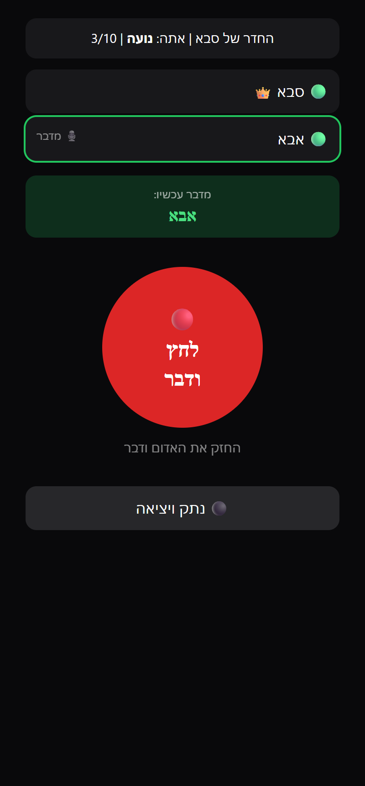

# 📻 ווקי-טוקי

ווקי-טוקי בדפדפן. המארח יוצר חדר ושולח קישור, החברים פותחים אותו, מכניסים קוד ומדברים.
לא צריך להתקין כלום או להירשם, ועד 10 אנשים יכולים להיות בחדר.

## ▶️ [לחצו כאן להפעלה](https://dor2500.github.io/walkie-talkie/)

**https://dor2500.github.io/walkie-talkie/**

## 🚀 איך משתמשים

1. **המארח** פותח את [הקישור](https://dor2500.github.io/walkie-talkie/), כותב שם ולוחץ **"צור ווקי-טוקי"**.
2. המארח מקבל **קישור הזמנה** ו**קוד כניסה של 4 ספרות**. את הקישור שולחים בוואטסאפ, בשיתוף או בהעתקה (או מציגים ברקוד), ואת הקוד אומרים בנפרד.
3. **החברים** פותחים את הקישור, כותבים שם וקוד כניסה ולוחצים **"הצטרף"**.
4. מחזיקים את **הכפתור האדום** ומדברים. כולם רואים מי מדבר עכשיו.

> המארח צריך להשאיר את הדף פתוח, כי דרכו מצטרפים חדשים.

## 📸 צילומי מסך

| 1. מארח: שם | 2. מארח: הזמנה | 3. מוזמן: שם + קוד |
|:---:|:---:|:---:|
|  |  |  |

| 4. מישהו מדבר | 5. אתה משדר |
|:---:|:---:|
|  |  |

## 🔒 אבטחה

- בקישור יש מזהה חדר אקראי של 16 תווים, כך שאי אפשר לנחש אותו.
- קוד הכניסה לא כתוב בקישור. המארח בודק אותו, וכל משתתף נבדק גם מול שאר המשתתפים.
- אחרי 5 ניסיונות שגויים הכניסה ננעלת ל-30 שניות.
- השמע עובר ישירות בין המכשירים ומוצפן (WebRTC: DTLS-SRTP).

## ⚙️ טכנולוגיה

הכל נמצא בקובץ אחד: [`index.html`](index.html).

- [PeerJS](https://peerjs.com/): חיבור P2P ושמע בזמן אמת
- [qrcodejs](https://github.com/davidshimjs/qrcodejs): ברקוד לקישור ההזמנה
- [Tailwind CSS](https://tailwindcss.com/): עיצוב

> המיקרופון דורש HTTPS, ולכן האתר מתפרסם דרך GitHub Pages.

## 📄 רישיון

[MIT](LICENSE)

