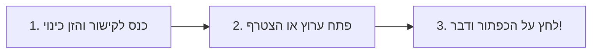

# 📻 ווקי-טוקי טקטי בענן | Tactical WebRTC Walkie-Talkie

[](https://dor2500.github.io/walkie-talkie/)
[](https://dor2500.github.io/walkie-talkie/)
[](https://webrtc.org/)
[](LICENSE)

מערכת מכשיר קשר (ווקי-טוקי) טקטית מתקדמת מבוססת דפדפן, הפועלת בזמן אמת בחיבור קולי ישיר (WebRTC P2P Mesh).  
**האפליקציה מאוחסנת בענן של GitHub וזמינה לשימוש מכל טלפון או מחשב ללא תלות במחשב המפתח!**

---

## 🌐 קישור להפעלה מיידית (פועל 24/7 ללא צורך במחשב פתוח!)

> ### 👉 **[https://dor2500.github.io/walkie-talkie/](https://dor2500.github.io/walkie-talkie/)**  
> **כל אחד יכול ללחוץ על הקישור, להזין כינוי ולהתחיל לדבר מיידית מהסמארטפון או מהמחשב.**  
> האפליקציה רצה ישירות דרך **GitHub Pages** ואינה דורשת התקנת תוכנה או שרת פרטי דולק.

---

## 📋 תוכן עניינים
1. [מדריך שימוש מהיר ב-3 צעדים](#-מדריך-שימוש-מהיר-ב-3-צעדים)
2. [תכונות עיקריות](#-תכונות-עיקריות)
3. [מדריך מפורט למסכי הממשק](#-מדריך-מפורט-למסכי-הממשק)
4. [מנוע הסאונד והרטט הטקטי](#-מנוע-הסאונד-והרפלקס-הטקטי)
5. [קיצורי מקלדת למחשב](#-קיצורי-מקלדת-למחשב-desktop-shortcuts)
6. [התקנה כאפליקציה בסמארטפון (PWA)](#-התקנה-כאפליקציה-בסמארטפון-pwa)
7. [ארכיטקטורת רשת ואבטחה (P2P Mesh)](#-ארכיטקטורת-רשת-ואבטחה-webrtc-mesh)
8. [שאלות ותשובות נפוצות (FAQ)](#-שאלות-ותשובות-נפוצות-faq)
9. [English Overview](#-english-overview)

---

## 🚀 מדריך שימוש מהיר ב-3 צעדים



1. **כניסה והזנת שם:** פתח את הקישור בדפדפן, כתוב כינוי קצר (למשל: "נשר 1", "סבא", "חמ״ל") ולחץ על **"התחבר לרשת הקשר"**.
2. **בחירת ערוץ:**
   - **מארח (Host):** לחיצה על "פתח רשת קשר חדשה" תייצר קוד ערוץ ייחודי וברקוד QR לשיתוף.
   - **מצטרף (Join):** לחיצה על "הצטרף לרשת קיימת" מאפשרת סריקת ברקוד QR במצלמה או הקלדת קוד הערוץ בן 6 התווים.
3. **שידור דיבור (PTT):** לחץ והחזק את הכפתור האדום הגדול (או מקש `Space` במחשב) ודבר. עם שחרור הכפתור תשמע צליל "רוג'ר" והערוץ יחזור למצב האזנה.

---

## ✨ תכונות עיקריות

- ⚡ **תקשורת מיידית ללא שיהוי (Sub-50ms Latency):** חיבור שמע ישיר ומבוזר מדפדפן לדפדפן בטכנולוגיית WebRTC.
- 🎛️ **קונסולה טקטית מתקדמת:** מסך LCD דיגיטלי מואר, מחוון עוצמת קליטה (RSSI), תדר צבאי מדומה וזיהוי חי של הדובר ברשת.
- 🔊 **מנוע סאונד מובנה (Web Audio API Synthesizer):** ביפ פתיחת שידור, רוג'ר ביפ ורעש סטטי אותנטי בסיום שידור (ללא צורך בקובצי mp3 חיצוניים).
- 📳 **משוב רטט טקטי (Haptic Feedback):** רטט מדויק בסמארטפונים בלחיצה על כפתור השידור ובשחרורו.
- 📊 **ספקטרוגרף גלי קול חי (Real-Time 60FPS Visualizer):** קנבס מונפש המציג את תנודות הקול של המשדר או המאזין.
- 🔒 **מצב נעילת שידור (Hands-Free):** מאפשר בלחיצה אחת להשאיר את המיקרופון פתוח ולחיצה נוספת לסגירה – אידיאלי בזמן הליכה, נהיגה או פעילות שטח.
- 📷 **סורק QR מובנה:** מאפשר לחברים להצטרף תוך שניה אחת בסריקת מסך הטלפון של המארח.
- 🌐 **אמינות שרתי STUN של Google:** פתרון מובנה למעבר חומות אש, נתבים ביתיים וחיבורים סלולריים (4G/5G).

---

## 🎛️ מדריך מפורט למסכי הממשק

### 1. מסך כניסה (`#nameScreen`)
* שדה הזנת כינוי – נשמר אוטומטית בזיכרון המכשיר (`localStorage`) כך שלא תצטרך להקליד שוב בכל כניסה.
* כפתור **"התחבר לרשת הקשר"**.

### 2. מסך בחירת תפקיד (`#welcomeScreen`)
* מציג כרטיס אישי עם האות הראשונה של שמך.
* **"פתח רשת קשר חדשה" (מארח):** פותח חדר חדש, מייצר קוד ומאפשר כניסה כרכז הערוץ.
* **"הצטרף לרשת קיימת":** מעביר למסך הזנת קוד או סריקה.

### 3. מסך המארח (`#hostScreen`)
* **קוד ערוץ (CHANNEL CODE):** קוד אותיות ומספרים גדול וברור עם כפתור העתקה בלחיצה אחת.
* **ברקוד QR מובנה:** מאפשר לכל מי שנמצא לידך לסרוק ולהצטרף מיד.
* **כפתור שיתוף לוואטסאפ / שיתוף מקורי:** שולח קישור חכם שמחבר את המקבל ישירות לערוץ.

### 4. מסך ההצטרפות (`#joinScreen`)
* **סורק ברקוד במצלמה:** מפעיל סורק מהיר ויעיל שמזהה את הברקוד מיד ומבצע חיבור אוטומטי.
* **הזנת קוד ידנית:** שדה מותאם לקוד בן 6 תווים.

### 5. עמדת השידור הטקטית (`#talkScreen`)
* **תצוגת LCD עליונה:** מציגה את קוד הערוץ, הכינוי שלך ומספר המחוברים הפעילים כרגע ברשת.
* **באנר סטטוס שידור:**
  * ⚪ *ערוץ פנוי להאזנה:* כאשר אף אחד אינו משדר.
  * 🔴 *משדר כעת (אתה):* כאשר המיקרופון שלך פתוח ומשדר לכולם.
  * 🟢 *שם המשתמש משדר:* מציג בדיוק מי מדבר ברגע זה ברשת.
* **מד גלי קול:** מציג גרפית את עוצמת ועושר השמע של הדובר.
* **כפתורי בורר מצב (Mode):**
  * `🔘 החזק (PTT)` - מצב מכשיר קשר קלאסי.
  * `🔒 נעילת שידור` - לחיצה אחת להפעלה ולחיצה נוספת לכיבוי.
* **כפתור ה-PTT המרכזי:** לחצן עגול תלת-ממדי גדול עם טבעות הילה מונפשות.
* **מגירת משתתפים (Connected Peers):** מציגה רשימה חיה של כל המשתתפים המחוברים בערוץ, כולל זיהוי בזמן אמת של מי מדבר.
* **כפתורי פעולה תחתונים:**
  * 📤 *הזמן חברים:* שיתוף קישור מיידי.
  * 📷 *קוד QR:* פותח חלונית עם ברקוד של החדר בכל רגע.
  * 🔌 *התנתק:* ניתוק בטוח וסגירת ערוצי הקול.

---

## 🔊 מנוע הסאונד והרפלקס הטקטי

האפליקציה כוללת מנוע סינתזת קול מבוסס **Web Audio API** שיוצר את כל האפקטים הקוליים ישירות בחומרת הסאונד של המכשיר בזמן אמת:
1. **צפצוף תחילת שידור (Chirp Tone):** מעבר תדר מהיר בין 1100Hz ל-1600Hz, המדמה פתיחת ערוץ במכשירי Motorola/Kenwood.
2. **רוג'ר ביפ ורעש סטטי (Roger Beep & Squelch):** צליל פיפ מדויק של 1050Hz המלווה בפרץ רעש לבן (White Noise) המסונן דרך Bandpass Filter בתדר 1400Hz.
3. **התראת שידור נכנס:** ביפ קל ונעים כאשר משתתף אחר מתחיל לדבר.
4. **כפתור השתקת אפקטים:** בראש המסך קיים כפתור רמקול להפעלה או השתקה של הצלילים לפי הצורך.

---

## ⌨️ קיצורי מקלדת למחשב (Desktop Shortcuts)

| מקש | פעולה | תיאור |
|:---:|:---:|:---|
| <kbd>Space</kbd> | **שידור PTT** | החזק את מקש הרווח לשידור ושחרר להאזנה |
| <kbd>L</kbd> | **נעילת שידור** | מעבר בין מצב החזקה למצב נעילה חופשית |
| <kbd>M</kbd> | **השתקת סאונד** | הפעלה/כיבוי של הביפים והאפקטים |

---

## 📲 התקנה כאפליקציה בסמארטפון (PWA)

האתר מותאם לעבודה במסך מלא כ-Web App עצמאית בסמארטפון:

### ב-iPhone / iPad (דפדפן Safari):
1. פתח את הקישור: [https://dor2500.github.io/walkie-talkie/](https://dor2500.github.io/walkie-talkie/)
2. לחץ על כפתור **השיתוף** בתחתית המסך (הריבוע עם החץ למעלה).
3. בחר ב-**"הוסף למסך הבית"** (Add to Home Screen).
4. כעת האפליקציה תיפתח ישירות ממסך הבית במסך מלא וללא שורת הכתובות של הדפדפן!

### ב-Android (דפדפן Chrome / Samsung Internet):
1. פתח את הקישור ב-Chrome.
2. לחץ על שלוש הנקודות בתפריט העליון (⋮).
3. בחר ב-**"הוספה למסך הבית"** או **"התקנת אפליקציה"**.

---

## 📶 ארכיטקטורת רשת ואבטחה (WebRTC Mesh)

```
       [Google STUN Server]
         /              \
        v                v
   [משתתף א'] <=====> [משתתף ב']
        \                /
         \              /
          v            v
          [משתתף ג']
```

* **תקשורת P2P מוצפנת:** השיחות אינן עוברות דרך שרת מקליט או מאחסן. המידע זורם ישירות בין המכשירים בהצפנת DTLS/SRTP בתקן WebRTC.
* **הפצת רשת Mesh אוטומטית:** כאשר משתמש חדש מתחבר למארח, פרוטוקול הסיגנל מפיץ את כתובות העמיתים כך שכל חבר בערוץ מתחבר ישירות לכל יתר החברים.
* **שרתי STUN רשמיים של Google:**
  * `stun:stun.l.google.com:19302`
  * `stun:stun1.l.google.com:19302`
  * מספקים מיפוי NAT מדויק המאפשר שיחה בין משתמשים ברשתות שונות (למשל סלולר 5G של סלקום מול Wi-Fi ביתי של בזק).

---

## ❓ שאלות ותשובות נפוצות (FAQ)

#### ש: האם המחשב של המפתח צריך להיות דולק כדי שהאפליקציה תעבוד?
**ת:** **לא, ממש לא!**  
האתר מתארח במלואו על גבי תשתית הענן המאובטחת של **GitHub Pages**, והקול מועבר ישירות בין המכשירים שלכם (P2P). המערכת זמינה 24 שעות ביממה, 7 ימים בשבוע ללא כל תלות במחשב אישי.

#### ש: הדפדפן מבקש אישור למיקרופון – האם זה בטוח?
**ת:** כן לחלוטין. הדפדפן מחייב הרשאת מיקרופון כדי לקלוט את הקול בזמן השידור. המיקרופון נשאר מושתק לחלוטין כל עוד אינך לוחץ על כפתור השידור.

#### ש: האם חבר יכול להצטרף רק באמצעות הקוד?
**ת:** כן. מספיק לתת לחבר את הקוד בן 6 התווים (למשל: `ABC123`). הוא נכנס למסך "הצטרף", מזין את הקוד ונכנס מיידית לערוץ. כמו כן, ניתן לשלוח לו ישירות את הקישור המלא שפותח את החדר אוטומטית.

#### ש: כמה משתתפים יכולים להיות בו-זמנית בערוץ?
**ת:** האפליקציה תומכת ברשת Mesh קבוצתית. החוויה אידיאלית לקבוצות של עד 8-12 משתתפים פעילים בו-זמנית ברשת קשר קבוצתית.

---

## 🌐 English Overview

**Tactical WebRTC Walkie-Talkie** is a zero-latency, peer-to-peer browser voice communication tool built with modern web technologies:

* **100% Cloud-Hosted & Standalone:** Hosted on GitHub Pages, operational 24/7 with zero dependency on local machines.
* **Direct WebRTC P2P Voice:** Sub-50ms latency using direct peer-to-peer audio mesh streaming.
* **Procedural Sound FX:** Realistic PTT chirp, roger beep, and squelch static synthesized entirely via the Web Audio API.
* **Modern Tactical UI:** High-contrast tactical LCD display, RSSI bars, 60FPS audio frequency spectrum visualizer, and skeuomorphic push-to-talk button.
* **Direct Share & QR Integration:** Built-in QR generator and camera scanner for rapid channel onboarding.

---

## 📄 רישיון (License)

פרויקט זה מופץ תחת רישיון **MIT**.  
חופשי לשימוש, התאמה ושיתוף!
