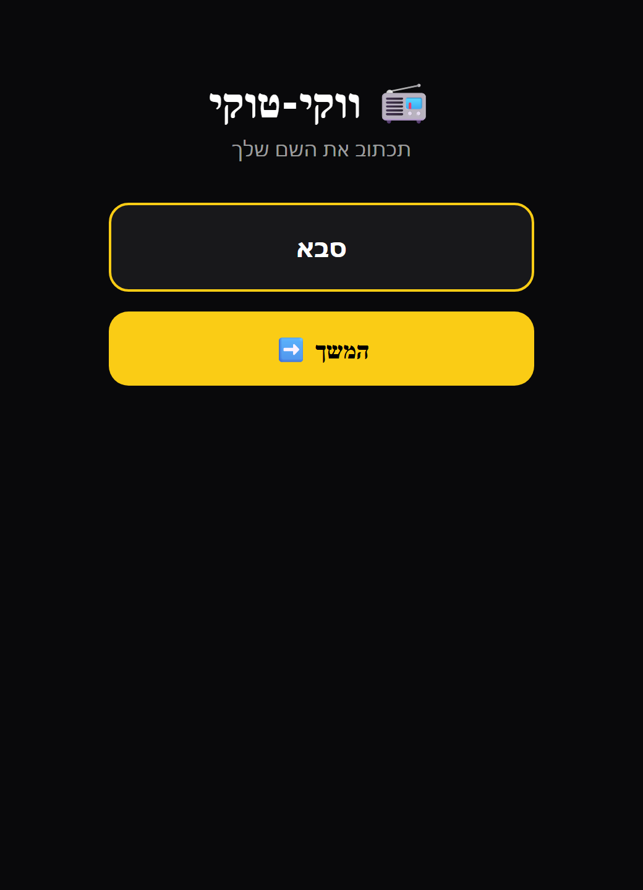
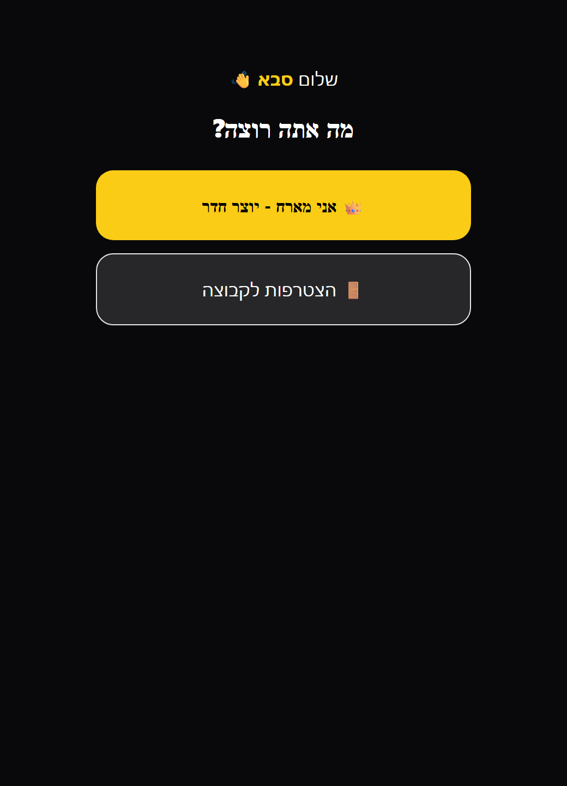
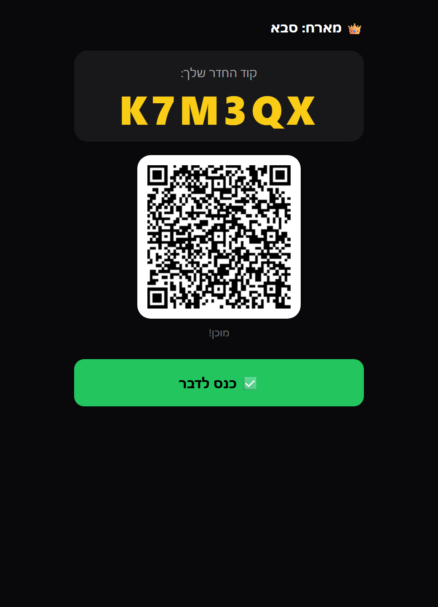
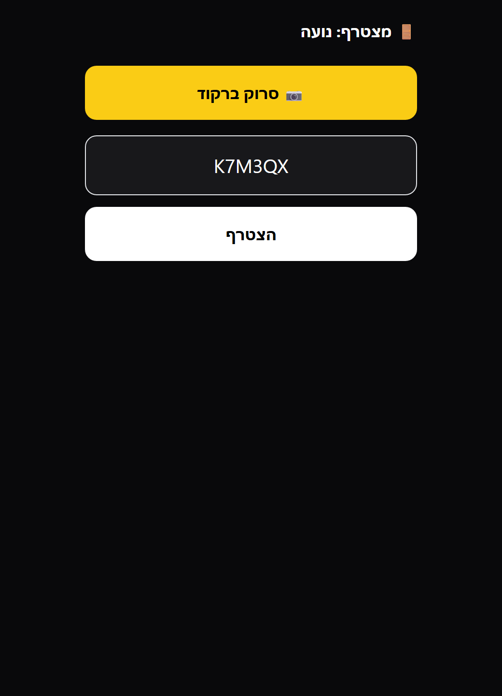
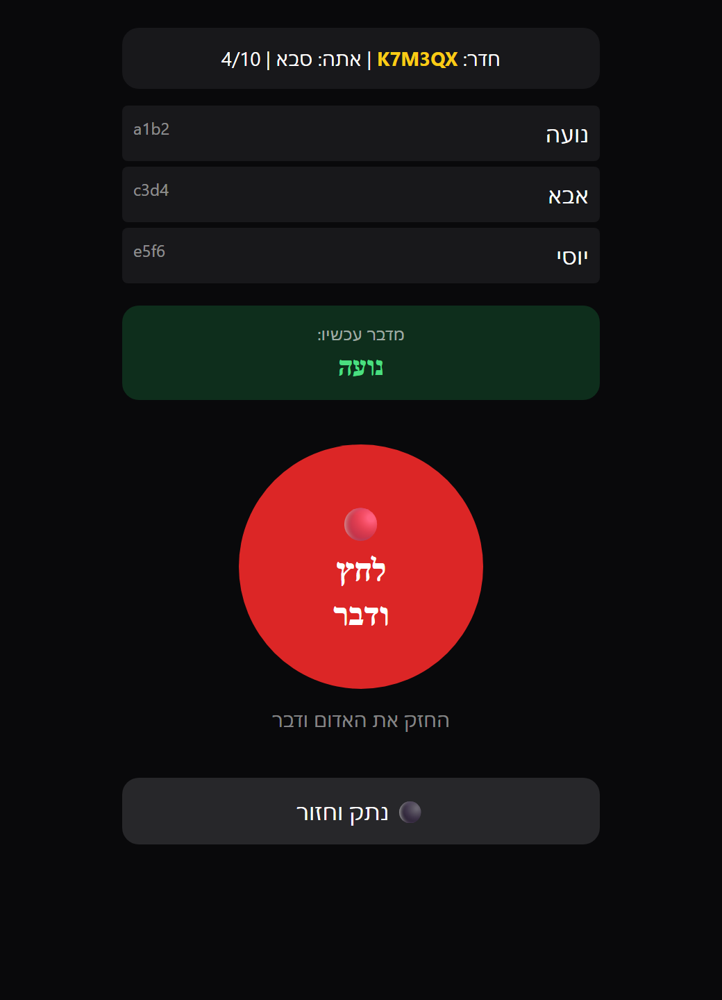

# 📻 ווקי-טוקי

ווקי-טוקי בדפדפן — לוחצים על הכפתור האדום ומדברים. בלי התקנה, בלי הרשמה, עד 10 אנשים בחדר.
השיחה עוברת ישירות בין המכשירים (WebRTC / P2P).

## ▶️ [לחצו כאן להפעלה](https://dor2500.github.io/walkie-talkie/)

**https://dor2500.github.io/walkie-talkie/**

## 📸 צילומי מסך

| 1. שם | 2. בחירה | 3. מארח — קוד + ברקוד |
|:---:|:---:|:---:|
|  |  |  |

| 4. הצטרפות | 5. לחץ ודבר |
|:---:|:---:|
|  |  |

## 🚀 איך משתמשים

1. פותחים את [הקישור](https://dor2500.github.io/walkie-talkie/) וכותבים שם.
2. **מארח:** לוחץ "אני מארח — יוצר חדר" ומקבל קוד חדר וברקוד.
3. **מצטרפים:** לוחצים "הצטרפות לקבוצה" וסורקים את הברקוד, או מקלידים את הקוד.
4. מאשרים גישה למיקרופון.
5. מחזיקים את **הכפתור האדום** ומדברים — כולם רואים מי מדבר עכשיו.

## ⚙️ טכנולוגיה

הכל בקובץ אחד: [`index.html`](index.html).

- [PeerJS](https://peerjs.com/) — חיבור P2P ושמע בזמן אמת
- [qrcodejs](https://github.com/davidshimjs/qrcodejs) — יצירת ברקוד לחדר
- [html5-qrcode](https://github.com/mebjas/html5-qrcode) — סריקת ברקוד במצלמה
- [Tailwind CSS](https://tailwindcss.com/) — עיצוב

> המיקרופון והמצלמה דורשים HTTPS, ולכן האתר מתפרסם דרך GitHub Pages.
> להרצה מקומית: פותחים את `index.html` בדפדפן (או מריצים שרת מקומי כמו `npx serve`).

## 📄 רישיון

[MIT](LICENSE)

