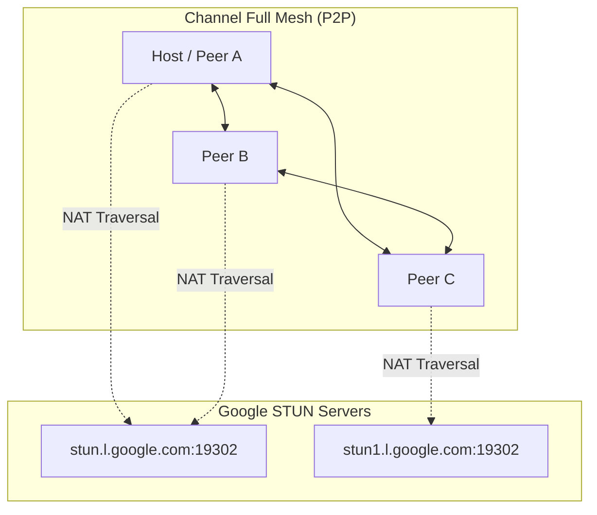
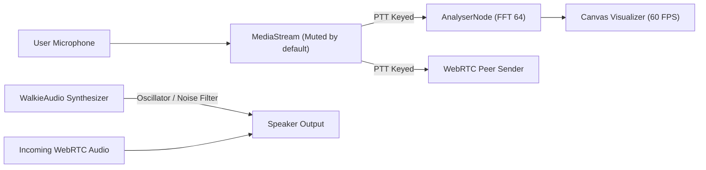

# 🏗️ Architecture & Technical Specification

Tactical WebRTC Walkie-Talkie is designed as a zero-server-dependency, client-side peer-to-peer (P2P) voice communications system.

```
walkie-talkie/
├── .github/
│   ├── workflows/deploy.yml          # Automated GitHub Pages CI/CD
│   └── ISSUE_TEMPLATE/               # Bug & feature templates
├── assets/
│   ├── css/
│   │   └── style.css                 # Cyberpunk/Tactical Dark CSS
│   ├── js/
│   │   ├── audio.js                  # Web Audio API Sound Synthesizer & Haptics
│   │   ├── webrtc.js                 # PeerJS Mesh & Google STUN Engine
│   │   ├── ui.js                     # Tactical LCD, 60fps Visualizer, Modals
│   │   └── app.js                    # Main App Controller & Event Loop
│   └── icons/
│       ├── icon.svg                  # High-res PWA icon
│       └── favicon.svg               # Crisp tactical favicon
├── docs/
│   └── ARCHITECTURE.md               # Technical documentation
├── index.html                        # Semantic HTML5 Application
├── manifest.json                     # PWA configuration
├── sw.js                             # Service worker for offline asset caching
├── package.json                      # Dev dependencies & scripts
├── LICENSE                           # MIT License
├── CONTRIBUTING.md                   # Contribution guidelines
├── CHANGELOG.md                      # Release log
└── README.md                         # Project documentation
```

---

## 1. Network Topology (P2P Full Mesh)



1. **Signaling:** Each room utilizes a readable 6-character room code prefixed as `walkie-{CODE}` on PeerJS public signaling.
2. **Mesh Discovery:** When Peer B joins the Host, the Host automatically broadcasts a `{ t: 'peers', peers: [...] }` discovery packet.
3. **Full Mesh Interconnection:** Peer B initiates direct WebRTC DataChannels and MediaConnections to Peer C, Peer D, etc., ensuring that voice flows directly between all devices with no single point of failure or relay bottle-neck.
4. **NAT Traversal:** Google STUN servers resolve public reflexive ICE candidates, overcoming symmetric / cone NATs across mixed Wi-Fi and mobile 4G/5G carriers.

---

## 2. Audio Pipeline & Web Audio API Synthesis



* **Microphone Safety:** When microphone access is granted, the audio track is initialized with `enabled = false`. The track is only active while the user holds the PTT button or toggles Lock mode.
* **PTT Chirp:** Ascending dual-sine frequency leap (1100Hz -> 1600Hz) generated via `OscillatorNode`.
* **Roger Beep & Squelch:** Generated by chaining a white noise buffer through a `BiquadFilterNode` (`bandpass` at 1400Hz, Q=1.8) paired with a 1050Hz pip tone.
* **Zero Audio Files:** 100% synthesized in client hardware memory, eliminating HTTP network latency and broken asset links.

---

## 3. Storage & Persistence

* `localStorage['walkie_user_name']`: Persists user handle across sessions.
* `localStorage['walkie_sound_fx']`: Stores sound mute preference.
* `sw.js` (Cache API): Caches static CSS, JS, fonts, and SVG assets for instant offline load.
